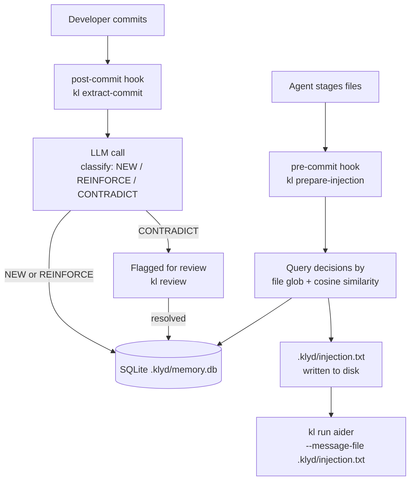

<div align="center">
  
</div>

# klyd

A decision memory harness for terminal coding agents. It installs Git hooks that extract architectural decisions from commits via LLM call, stores them locally in SQLite, and injects the relevant decisions into an agent's context window at the next write.

[PyPI: klyd](https://pypi.org/project/klyd/) · [GitHub](https://github.com/klyd-studio/klyd-harness) · [License: MIT](./LICENSE)

---

## The problem

Terminal coding agents fail in a predictable loop when working on a codebase over multiple sessions:

1. Agent writes code that passes a test.
2. A later agent session reads that code as ground truth.
3. Decisions made in session 1 (e.g., "use SQLite, not an ORM", "all auth must go through `verify_token`") are invisible in session 2.
4. The agent makes a contradictory decision. The codebase accumulates conflicting patterns.

This is a memory and context problem, not a model quality problem. The agent is not bad at coding — it does not know what decisions the project has already made.

---

## Architecture

`klyd` does not wrap the agent subprocess or run a background service. It uses Git hooks as the interception point: `post-commit` extracts decisions, `pre-commit` generates the injection file.



All state is local. There is no cloud dependency, no background process, and no persistent network connection.

---

## What I built

**Core extraction and injection loop** (`klyd/cli.py`, `klyd/extractor.py`, `klyd/db.py`):
- `kl extract-commit` — calls `git diff HEAD~1 HEAD` and the commit message, sends both to the configured LLM, and classifies the output into `NEW`, `REINFORCE`, or `CONTRADICT` events.
- `kl prepare-injection` — retrieves staged file names via `git diff --cached --name-only`, queries the database for relevant decisions, and writes the injection file.
- `kl review` — interactive terminal UI for resolving `CONTRADICT` flags, with options to accept, reject, edit, or merge (merge triggers a second LLM call to negotiate a unified rule).
- `kl run <agent>` — wraps agent execution, passing the injection file as a context argument.

**Multi-provider BYOK support**: Anthropic, OpenAI, OpenRouter, Google Gemini, Groq — configured via `kl config`.

---

## Technical challenges

### Custom glob matching inside SQLite

When a developer commits `auth/login.py`, the injection engine needs to find all decisions whose `file_patterns` field (e.g., `auth/*, security/*`) matches that path. Running this in application memory requires a full table scan and a Python loop over all stored decisions.

Instead, the engine registers a Python function directly into the SQLite C runtime using `conn.create_function`:

```python
def _match_any_file(file_patterns: str, file_list_str: str) -> int:
    patterns = [p.strip() for p in file_patterns.split(',')]
    files = file_list_str.split('|')
    for f in files:
        for p in patterns:
            if fnmatch.fnmatch(f, p):
                return 1
    return 0

conn.create_function("match_files", 2, _match_any_file)
```

This makes `match_files` available as a SQL function inside the query planner. The full relevance ranking query — combining glob match score, cosine similarity of the embedding, and recency — runs as a single SQL statement without pulling rows into Python first. Source: [`klyd/db.py`](./klyd/db.py).

### Decision lineage with recursive CTEs

When a `CONTRADICT` event is resolved by merging two decisions, the old decision is not deleted. The database tracks a `parent_decision_id` column and the full ancestry chain is queryable via a recursive CTE:

```sql
WITH RECURSIVE ancestors(id, decision, parent_decision_id) AS (
    SELECT id, decision, parent_decision_id FROM decisions WHERE id = ?
    UNION ALL
    SELECT d.id, d.decision, d.parent_decision_id
    FROM decisions d JOIN ancestors a ON d.id = a.parent_decision_id
)
SELECT * FROM ancestors;
```

This provides a complete history of how an architectural rule evolved across commits, which is useful when debugging why the agent was given a specific instruction.

---

## Quick start

```bash
pip install klyd

cd your-project
kl init                        # creates .klyd/, installs git hooks
kl config --api-key sk-ant-... # or --openai-key, --gemini-key, etc.

# make a commit with an architectural decision
git add db.py && git commit -m "feat: use SQLite, not Postgres"

kl status      # shows extracted decisions
kl run aider   # runs aider with decisions injected into context
```

To resolve a flagged conflict:

```bash
kl review
```

---

## Current status and limitations

**Status: experimental.** Latest release is v0.2.2, distributed on PyPI.

- The extraction quality depends on the configured LLM's ability to identify what counts as an architectural decision in a commit diff. Small style commits are usually ignored correctly; large refactors with many unrelated changes may produce noisy output.
- Cosine similarity ranking requires embeddings. If no embedding model is configured, ranking falls back to glob-only matching.
- Designed for single-developer use. There is no multi-user conflict resolution or remote sync.
- `kl run` supports `aider` and `opencode` argument formats directly. Other agents require manual use of `--message-file .klyd/injection.txt`.

---

## Verification

Run the database unit tests:

```bash
pip install .
pytest test_db.py -v
```

CI runs on Python 3.11 via GitHub Actions on every push to `main`. PyPI releases are triggered by version tags via the `publish.yml` workflow.
