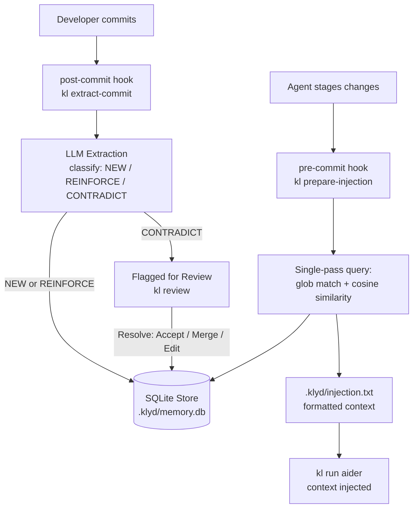

<div align="center">
  
</div>

# KLYD

### Decision memory for coding agents.

Coding agents can generate code quickly but often lose the architectural decisions that shaped a repository.

Klyd records, retrieves, and reintroduces those decisions so future agent sessions can work with the project's existing reasoning instead of repeatedly rediscovering it.

[PyPI: klyd](https://pypi.org/project/klyd/) · [GitHub](https://github.com/klyd-studio/klyd-harness) · [License: MIT](./LICENSE)

---

## The problem

A coding agent may know the current files but not the reasons behind them:

- why a database choice was made;
- why a workaround exists;
- why an API must remain stable;
- why a previous approach was rejected;
- which architectural constraints are non-negotiable.

Without that context, agents can produce locally plausible changes that violate the system's existing design. Over multiple sessions, a codebase accumulates conflicting architectural patterns, turning into a patchwork of fragmented decisions.

---

## The workflow

Klyd operates invisibly through standard Git hooks without requiring a background daemon or wrapping agent subprocesses with intrusive proxies:



All state remains strictly local to `.klyd/` inside the target git repository.

---

## Example

A repository previously decided:

> Authentication must remain inside the existing WebCrypto-based boundary. External token libraries must not be introduced.

Months later, an autonomous agent tasked with fixing an auth endpoint proposes adding a third-party token parser.

Before the change is committed, Klyd inspects the staged files, retrieves the earlier decision and its rationale from `.klyd/memory.db`, and injects the constraint directly into the agent's context window. The agent refactors the code within the established WebCrypto pattern instead of introducing an incompatible dependency.

*(Note: This is an illustrative example of an architectural boundary constraint captured from commit history and reintroduced to guide subsequent agent turns).*

---

## Technical design

Klyd currently uses:

- **SQLite for persistent decision storage**: Embedded relational database maintaining schema versions, embeddings, and decision records.
- **Git hooks for repository lifecycle integration**: `post-commit` extracts decisions asynchronously from diffs; `pre-commit` prepares context from staged changes.
- **Semantic similarity for retrieval**: Optional vector embeddings paired with lexical glob matching for relevant context ranking.
- **Recursive decision ancestry**: Tracking parent-child relationships across decision versions using recursive Common Table Expressions.
- **Conflict resolution between related decisions**: Interactive terminal UI (`kl review`) supporting accept, reject, manual edit, and LLM-assisted decision merging.
- **Multiple model-provider integrations**: Bring-Your-Own-Key (BYOK) support for Anthropic, OpenAI, OpenRouter, Google Gemini, and Groq.
- **CLI-oriented workflow for coding-agent environments**: Direct compatibility flags for tools like `aider` and `opencode`.

---

## Design choice: SQLite

SQLite keeps the decision history:

- **local** to the repository or workspace;
- **inspectable** with standard SQL tools or CLI commands;
- **easy to back up** by copying `.klyd/`;
- **usable** without requiring any cloud service, daemon, or database server;
- **available** to low-latency command-line workflows and shell scripts.

The trade-off is that Klyd prioritizes local developer infrastructure and explicit Git workflow integration over centralized multi-user cloud coordination.

---

## Engineering details

### In-database custom multi-glob matching

When staged files are evaluated (e.g. `auth/login.py`), Klyd must match them against comma-separated glob patterns (e.g. `auth/*, security/*`) stored in the `decisions` table. Standard SQL lacks native glob-list evaluation, and loading all rows into Python memory for full-table scanning creates unnecessary overhead.

Klyd solves this by registering a custom Python callback function (`match_files`) directly into the SQLite C-runtime using `sqlite3.Connection.create_function`:

```python
def _match_any_file(file_patterns: str, file_list_str: str) -> int:
    patterns = [p.strip() for p in file_patterns.split(",")]
    files = file_list_str.split("|")
    for f in files:
        for p in patterns:
            if fnmatch.fnmatch(f, p):
                return 1
    return 0

conn.create_function("match_files", 2, _match_any_file)
```

This allows the SQLite query planner to filter rows atomically in a single pass at the database layer before sorting by relevance and recency.

### Decision lineage with recursive CTEs

When conflicting decisions are merged or updated during human review, older decisions are soft-archived rather than overwritten. Lineage is tracked through `parent_decision_id`, allowing complete evolutionary trees to be reconstructed using recursive Common Table Expressions:

```sql
WITH RECURSIVE ancestors(id, decision, parent_decision_id) AS (
    SELECT id, decision, parent_decision_id FROM decisions WHERE id = ?
    UNION ALL
    SELECT d.id, d.decision, d.parent_decision_id
    FROM decisions d JOIN ancestors a ON d.id = a.parent_decision_id
)
SELECT * FROM ancestors;
```

---

## Quickstart

### 1. Install Klyd

```bash
pip install klyd
```

### 2. Initialize a repository

Run inside the root of your Git repository:

```bash
kl init
```

This creates `.klyd/memory.db`, initializes the configuration file, and installs the Git hooks into `.git/hooks/`.

### 3. Configure a model provider

Set your preferred API key (BYOK):

```bash
kl config --api-key sk-ant-...
# or: kl config --openai-key sk-...
# or: kl config --gemini-key ...
# or: kl config --groq-key ...
```

Inspect active configuration:

```bash
kl config --show
```

### 4. Record decisions from commits

Decisions are automatically extracted by the `post-commit` hook whenever you make a Git commit:

```bash
git commit -m "refactor(db): use SQLite connection pooling instead of global instances"
```

You can also trigger extraction manually for the latest commit:

```bash
kl extract-commit
```

### 5. Retrieve relevant decisions

View stored architectural decisions in a table:

```bash
kl status
```

Filter decisions by search keyword:

```bash
kl status --search "database"
```

View decisions grouped by module hierarchy:

```bash
kl status --tree
```

### 6. Run an agent with decision memory

Launch your coding agent wrapped with Klyd context:

```bash
kl run aider
```

For custom agent invocations, generate the injection context directly:

```bash
kl prepare-injection
# Context is written to .klyd/injection.txt
```

---

## Commands reference

| Command | Description |
|---|---|
| `kl init` | Initialise `.klyd/` storage and install Git hooks. |
| `kl config` | Configure model API keys, templates, and extraction thresholds. |
| `kl extract-commit` | Extract architectural decisions from the latest Git commit. |
| `kl prepare-injection` | Query matching decisions for staged files and generate `.klyd/injection.txt`. |
| `kl preview-injection` | Preview the injection prompt without writing it to disk. |
| `kl status` | Display active decisions, conflict summaries, and drift statistics. |
| `kl review` | Interactive CLI to resolve flagged architectural conflicts (`accept`, `merge`, `edit`, `reject`). |
| `kl pin <id>` | Pin a non-negotiable architectural constraint so it is always injected. |
| `kl unpin <id>` | Remove a pinned decision constraint. |
| `kl run <agent>` | Execute a coding agent with memory injected via command-line arguments. |
| `kl metrics` | Display aggregated decision counts, average confidence, and conflict rates. |

---

## Current status

Klyd is an actively developed developer-tooling project (v0.2.2 distributed on PyPI).

The current implementation is focused on local decision persistence, retrieval, Git lifecycle integration, and terminal coding-agent workflows.

- **Local scope**: Designed for single-developer repository workspaces. Remote peer sync and multi-user concurrent locking are not included.
- **LLM extraction dependency**: Quality of extracted decisions correlates with commit message clarity and the reasoning capabilities of the configured model.
- **Agent support**: Native argument injection is configured for `aider` and `opencode`; other agents consume `.klyd/injection.txt` via their respective context-file arguments.

---

## License

MIT License — see [LICENSE](./LICENSE).
